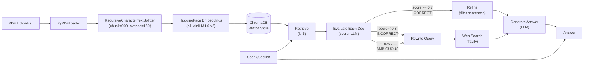

<p align="center">
  <a href="https://chatpdf-crag.streamlit.app/" target="_blank">
    
  </a>
</p>

<p align="center">
  <a href="https://chatpdf-crag.streamlit.app/" target="_blank">
    
  </a>
</p>

<p align="center">
  <a href="#features">Features</a> ·
  <a href="#architecture">Architecture</a> ·
  <a href="#standalone-scripts">Standalone Scripts</a> ·
  <a href="#quick-start">Quick Start</a> ·
  <a href="#deployment">Deployment</a> ·
  <a href="#project-structure">Structure</a> ·
  <a href="#contributing">Contributing</a>
</p>

<p align="center">
  
  
  
  
  
  
  
  
  
  
</p>

---

Upload PDFs and ask questions using a **Corrective RAG (CRAG)** pipeline that evaluates retrieval quality, routes between document and web sources, and synthesizes grounded answers.

## Features

- **Corrective RAG Pipeline** — 6-node LangGraph graph that evaluates each retrieved chunk, then routes between document refinement or web search based on relevance scores
- **Multi-Source Routing** — CORRECT (score >= 0.7) refines document chunks, INCORRECT (< 0.3) and AMBIGUOUS (mixed) fall back to Tavily web search
- **Multi-PDF Ingestion** — Upload one or more PDFs, search across all at once
- **Sentence-Level Filtering** — Refines retrieved chunks into sentences, then keeps only relevant ones before generation
- **Dual LLM Fallback Chains** — Generation: Mistral -> Groq; Scoring: Gemini with optional Mistral backup for rate limits
- **Persistent Vector Store** — ChromaDB with HuggingFace embeddings (all-MiniLM-L6-v2)
- **Streamlit Chat UI** — Clean chat interface with avatars, suggestion chips, and custom styling

## Architecture



| Component | Stack |
|---|---|
| **Frontend** | Streamlit (chat UI, avatars, suggestion chips) |
| **Orchestration** | LangGraph StateGraph (6 nodes, conditional edges) |
| **Document Loading** | PyPDFLoader + RecursiveCharacterTextSplitter (900 chars, 150 overlap) |
| **Embeddings** | HuggingFace `all-MiniLM-L6-v2` |
| **Vector Store** | ChromaDB (persistent local storage, similarity search k=5) |
| **Generation LLM** | Mistral `mistral-small-latest` -> Groq `gpt-oss-120b` fallback |
| **Scorer LLM** | Gemini `gemini-flash-lite-latest` (optional Mistral backup via second API key to avoid rate limits) |
| **Web Search** | Tavily (lazy-initialized, optional) |
| **Secrets** | `st.secrets` with `os.getenv()` fallback |

## Standalone Scripts

`app.py` and `create_database.py` are the **original single-file versions** of the pipeline — the stepping stones that grew into the full ChatPDF app. `app.py` runs a basic RAG chain using Groq Llama 3.3 70B with MMR retrieval and a simple prompt, no evaluation or web search fallback. `create_database.py` loads a single PDF, splits it into chunks, and builds the ChromaDB vector store locally.

Use them as a reference for the pipeline logic, or run them standalone:

```bash
python create_database.py
python app.py
```

The full ChatPDF app (`frontend.py` + `backend.py`) is the evolved version — a Corrective RAG pipeline with LangGraph, chunk evaluation, web search fallback, sentence-level filtering, and a polished Streamlit chat UI.

## Quick Start

```bash
git clone https://github.com/kairav7220/ChatPDF.git
cd ChatPDF
pip install -r requirements.txt
```

Set your API keys in `.env`:

```env
MISTRAL_API_KEY="your-mistral-key"
MISTRAL_API_KEY_2="your-second-mistral-key"
GROQ_API_KEY="your-groq-key"
GOOGLE_API_KEY="your-google-gemini-key"
HUGGINGFACE_API_TOKEN="your-hf-token"
TAVILY_API_KEY="your-tavily-key"
```

```bash
streamlit run frontend.py
```

## How It Works

1. **Upload** — Add PDFs via the sidebar and click "Index documents". PDFs are split into chunks (900 chars, 150 overlap) and embedded into ChromaDB.
2. **Retrieve** — System fetches the 5 most similar chunks from ChromaDB using cosine similarity.
3. **Evaluate** — Each retrieved chunk is scored for relevance (0.0-1.0) by the scorer LLM. Chunks scoring >= 0.7 are marked as good.
4. **Route** — Based on scores:
   - **CORRECT** (at least one chunk >= 0.7): Filter good chunks through sentence-level relevance check, then generate answer from refined context.
   - **INCORRECT** (all chunks < 0.3): Rewrite the question into a web search query, search via Tavily, generate answer from web results.
   - **AMBIGUOUS** (mixed scores, none >= 0.7 but not all < 0.3): Same path as INCORRECT — rewrite and search the web.

## Deployment

On Streamlit Community Cloud, add your keys in **Settings > Secrets**:

```toml
MISTRAL_API_KEY = "your-mistral-key"
MISTRAL_API_KEY_2 = "your-second-mistral-key"
GROQ_API_KEY = "your-groq-key"
GOOGLE_API_KEY = "your-google-gemini-key"
HUGGINGFACE_API_TOKEN = "your-hf-token"
TAVILY_API_KEY = "your-tavily-key"
CHROMA_DIR = "chroma_db"
```

## Project Structure

```
ChatPDF/
├── frontend.py              # Streamlit UI (chat, avatars, suggestion chips)
├── backend.py               # CRAG pipeline (LangGraph, 6 nodes, dual LLM chains)
├── app.py                   # Original standalone RAG chain (reference)
├── create_database.py       # Original ChromaDB builder (reference)
├── requirements.txt         # Python dependencies
├── CONTRIBUTING.md          # Contribution guide
├── .env.example             # Required API keys template
├── .gitignore
├── .streamlit/
│   ├── config.toml          # App theme
│   └── secrets.toml         # Your API keys (gitignored)
└── chroma_db/               # Persistent vector store (gitignored)
```

## License

MIT © [kairav7220](https://github.com/kairav7220)

---

<p align="center">
  Built with <a href="https://python.langchain.com">LangChain</a> ·
  <a href="https://langchain-ai.github.io/langgraph/">LangGraph</a> ·
  <a href="https://www.trychroma.com">ChromaDB</a> ·
  <a href="https://mistral.ai">Mistral</a> ·
  <a href="https://groq.com">Groq</a> ·
  <a href="https://ai.google.dev/gemini-api">Gemini</a> ·
  <a href="https://tavily.com">Tavily</a> ·
  <a href="https://huggingface.co/sentence-transformers">Sentence Transformers</a>
</p>
